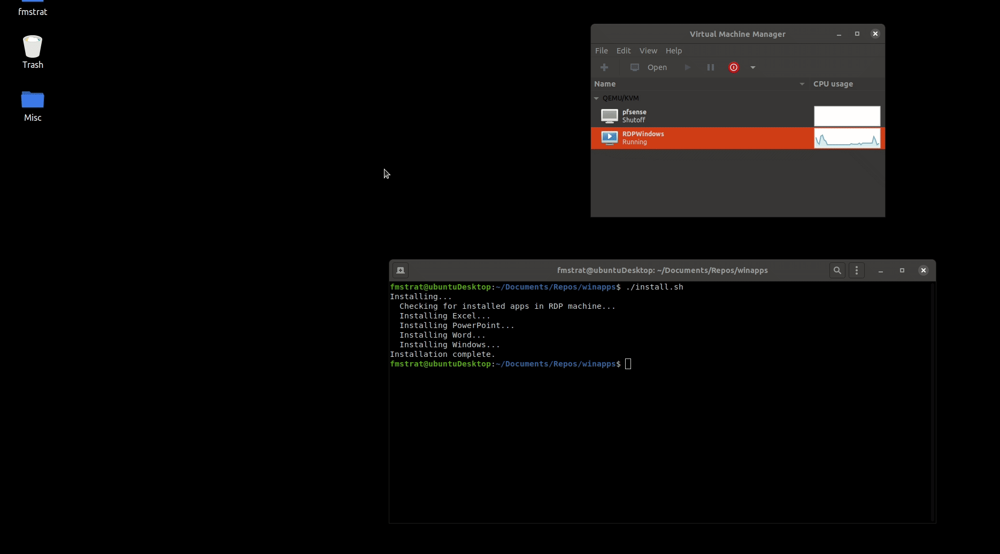
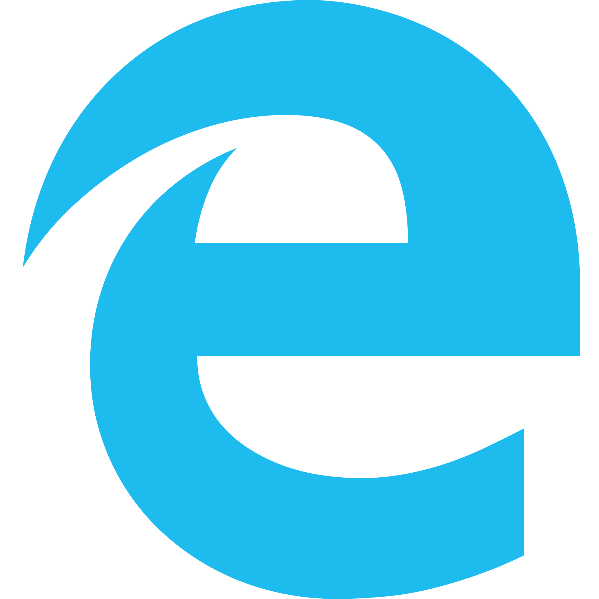
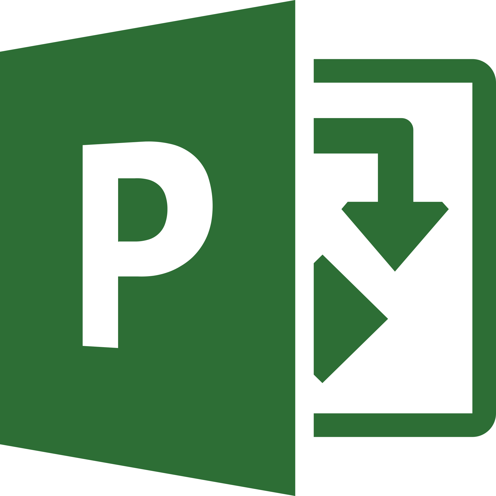
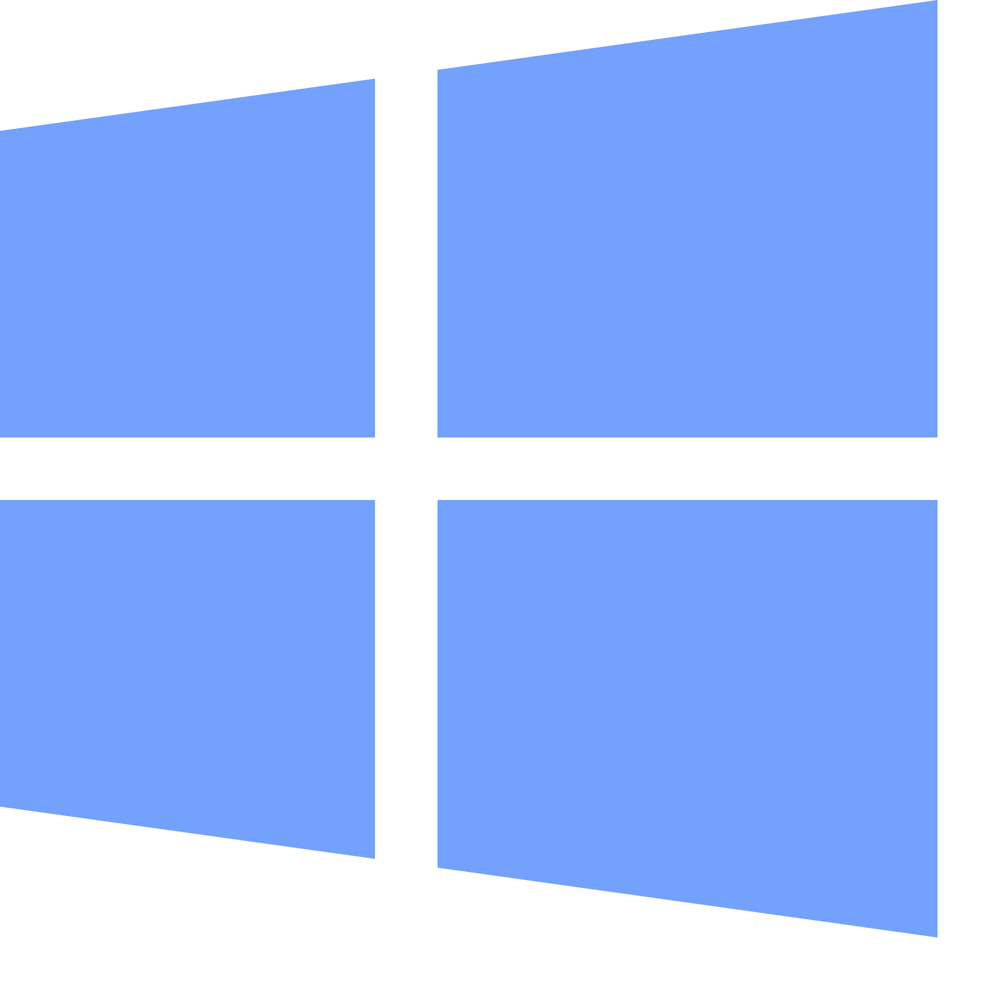

# WinApps for Linux

Run Windows apps such as Microsoft Office/Adobe in Linux (Ubuntu/Fedora) and GNOME/KDE as if they were a part of the native OS, including Nautilus integration for right clicking on files of specific mime types to open them.

***Proud to have made the top spot on [r/linux](https://www.reddit.com/r/linux) on launch day.***

## How it works
WinApps was created as an easy, one command way to include apps running inside a VM (or on any RDP server) directly into GNOME as if they were native applications. WinApps works by:
- Running a Windows RDP server in a background VM container
- Checking the RDP server for installed applications such as Microsoft Office
- If those programs are installed, it creates shortcuts leveraging FreeRDP for both the CLI and the GNOME tray
- Files in your home directory are accessible via the `\\tsclient\home` mount inside the VM
- You can right click on any files in your home directory to open with an application, too

## Currently supported applications
### WinApps supports ***ANY*** installed application on your system.

It does this by:
1. Scanning your system for offically configured applications (below)
2. Scanning your system for any other EXE files with install records in the Windows Registry

Any officially configured applications will have support for high-resolution icons and mime types for automatically detecting what files can be opened by each application. Any other detected executable files will leverage the icons pulled from the EXE.

Note: The officially configured application list below is fueled by the community, and therefore some apps may be untested by the WinApps team.

<table cellpadding="10" cellspacing="0" border="0">
  <tr>
    <td></td><td>Adobe Acrobat Pro (X)</td>
    <td></td><td>Adobe Acrobat Reader (DC)</td>
  </tr>
  <tr>
    <td></td><td>Adobe After Effects (CC)</td>
    <td></td><td>Adobe Audition (CC)</td>
  </tr>
  <tr>
    <td></td><td>Adobe Bridge (CS6, CC)</td>
    <td></td><td>Adobe Creative Cloud (CC)</td>
  </tr>
  <tr>
    <td></td><td>Adobe Illustrator (CC)</td>
    <td></td><td>Adobe InDesign (CC)</td>
  </tr>
  <tr>
    <td></td><td>Adobe Lightroom (CC)</td>
    <td></td><td>Adobe Photoshop (CS6, CC)</td>
  </tr>
  <tr>
    <td></td><td>Adobe Premiere Pro (CC)</td>
    <td></td><td>Authy</td>
  </tr>
  <tr>
    <td></td><td>Command Prompt (cmd.exe)</td>
    <td></td><td>Explorer (File Manager)</td>
  </tr>
  <tr>
    <td></td><td>Internet Explorer (11)</td>
    <td></td><td>Microsoft Access (2016, 2019, o365)</td>
  </tr>
  <tr>
    <td></td><td>Microsoft Excel (2016, 2019, o365)</td>
    <td></td><td>Microsoft Word (2016, 2019, o365)</td>
  </tr>
  <tr>
    <td></td><td>Microsoft OneNote (2016, 2019, o365)</td>
    <td></td><td>Microsoft Outlook (2016, 2019, o365)</td>
  </tr>
  <tr>
    <td></td><td>Microsoft PowerPoint (2016, 2019, o365)</td>
    <td></td><td>Microsoft Project (2016, 2019, o365)</td>
  </tr>
  <tr>
    <td></td><td>Microsoft Publisher (2016, 2019, o365)</td>
    <td></td><td>Powershell (Standard, Core)</td>
  </tr>
  <tr>
    <td></td><td>Visual Studio (2019 - Ent|Pro|Com)</td>
    <td></td><td>Windows (Full RDP session)</td>
  </tr>
</table>

## Documentation

Latest documentation available at: [https://nowsci.com/winapps/](https://nowsci.com/winapps/)

